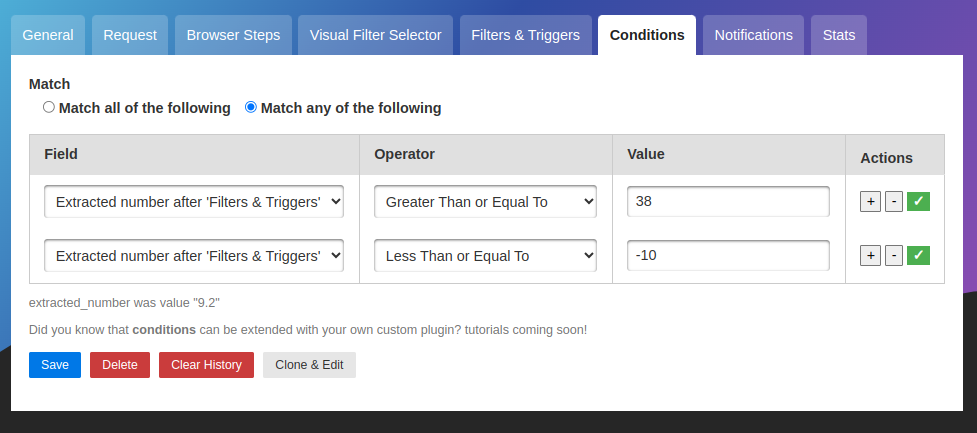
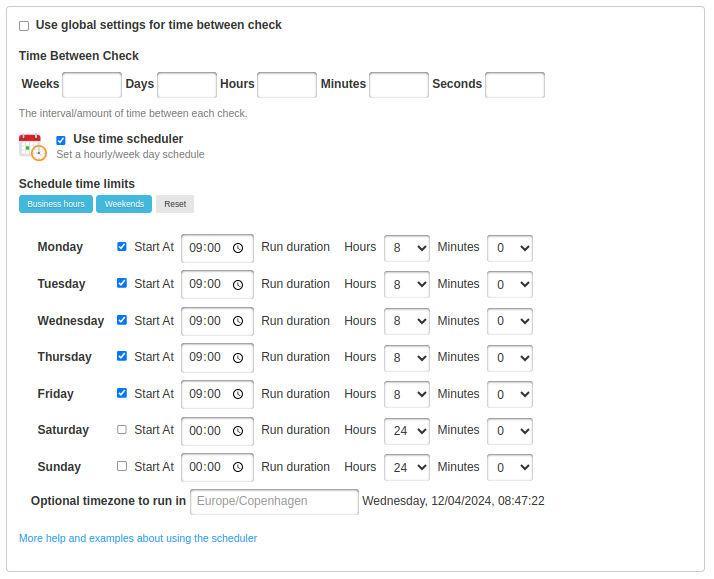
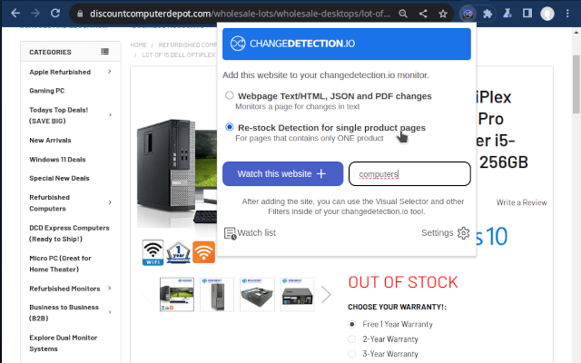

# Detect Website Changes Automatically — Monitor Web Page Changes in Real Time

Monitor websites for updates — get notified via Discord, Email, Slack, Telegram, Webhook and many more.

**Detect web page content changes and get instant alerts.**  

Ideal for monitoring price changes, content edits, conditional changes and more.


[](https://changedetection.io?src=github)

[![Release Version][release-shield]][release-link] [![Docker Pulls][docker-pulls]][docker-link] [![License][license-shield]](LICENSE.md)


[**Get started with website page change monitoring straight away. Don't have time? Try our $8.99/month subscription, use our proxies and support!**](https://changedetection.io) , _half the price of other website change monitoring services!_


Easily [configure conditional actions](https://changedetection.io/tutorial/conditional-actions-web-page-changes), for example, only trigger when a price is above or below a preset amount, or [when a web page includes (or does not include) a keyword](https://changedetection.io/tutorial/how-monitor-keywords-any-website)



### Schedule web page watches in any timezone, limit by day of week and time.

Easily set a re-check schedule, for example you could limit the web page change detection to only operate during business hours.
Or perhaps based on a foreign timezone (for example, you want to check for the latest news-headlines in a foreign country at 0900 AM),



Includes quick short-cut buttons to setup a schedule for **business hours only**, or **weekends**.

### We have a Chrome extension!

Easily add the current web page to your changedetection.io tool, simply install the extension and click "Sync" to connect it to your existing changedetection.io install.

[](https://chromewebstore.google.com/detail/changedetectionio-website/kefcfmgmlhmankjmnbijimhofdjekbop)

[Goto the Chrome Webstore to download the extension.](https://chromewebstore.google.com/detail/changedetectionio-website/kefcfmgmlhmankjmnbijimhofdjekbop) ( Or check out the [GitHub repo](https://github.com/dgtlmoon/changedetection.io-browser-extension) ) 

## Installation

### Docker

With Docker composer, just clone this repository and..

```bash
$ docker compose up -d
```

Docker standalone
```bash
$ docker run -d --restart always -p "127.0.0.1:5000:5000" -v datastore-volume:/datastore --name changedetection.io dgtlmoon/changedetection.io
```

